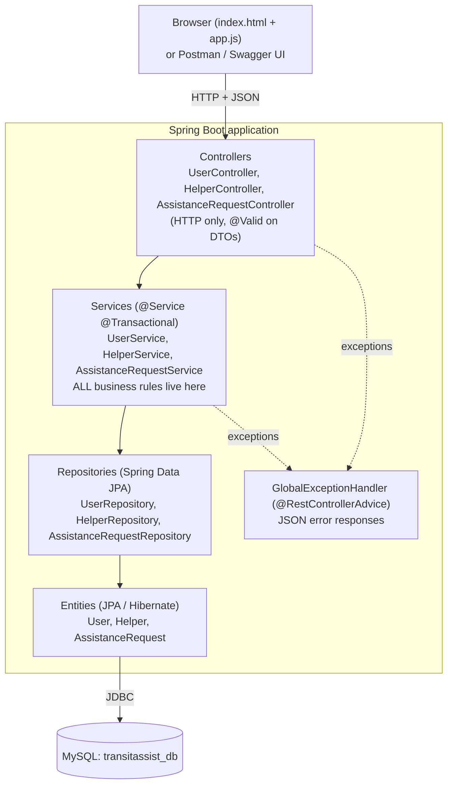
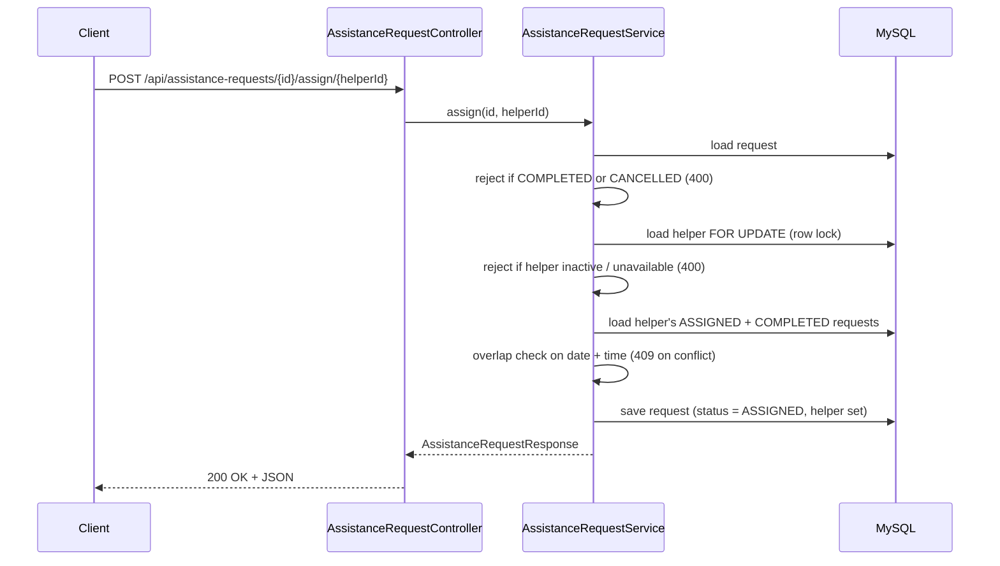

# Architecture

TransitAssist is a classic layered Spring Boot application.

| Layer | Package | Responsibility |
|-------|---------|----------------|
| Controller | `controller` | Map URLs to service calls, validate DTOs, choose HTTP status |
| Service | `service` | Business rules, state transitions, transactions |
| Repository | `repository` | Database access through `JpaRepository` |
| Entity | `entity` | Tables and relationships |
| DTO | `dto` | Request / response objects (entities are never exposed) |
| Exception | `exception` | `ResourceNotFoundException`, `BusinessRuleException`, `GlobalExceptionHandler` |
| Config | `config` | `DataInitializer` (demo data), `OpenApiConfig` (Swagger) |

## Assign-helper sequence

## Overlap rule

Every request occupies a slot of `transitassist.assistance-duration-minutes` (default **60**) starting at its trip
time. Two slots overlap when `startA < endB AND startB < endA`. So 10:00 and 10:30 overlap, 10:00 and 11:00 do not.
