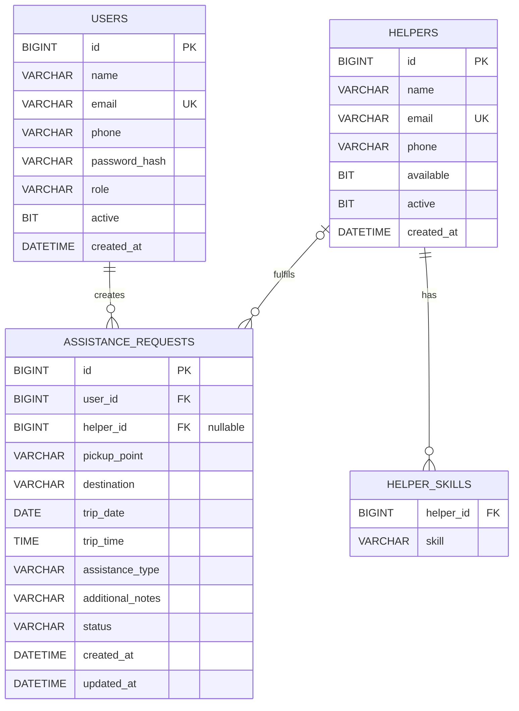

# Database Schema

Database: `transitassist_db` (MySQL). Tables are created automatically by Hibernate (`ddl-auto=update`).
A reference SQL script is in [`database/schema.sql`](../database/schema.sql).

## Indexes on `assistance_requests`
`idx_ar_user (user_id)`, `idx_ar_helper (helper_id)`, `idx_ar_trip_date (trip_date)`, `idx_ar_status (status)`.

## Relationships
* **users 1 — * assistance_requests** (`assistance_requests.user_id`, NOT NULL)
* **helpers 1 — * assistance_requests** (`assistance_requests.helper_id`, NULL until assigned)
* **helpers 1 — * helper_skills** (`@ElementCollection`, one row per skill)

Enums (`role`, `assistance_type`, `status`, `skill`) are stored as text with `@Enumerated(EnumType.STRING)`.
